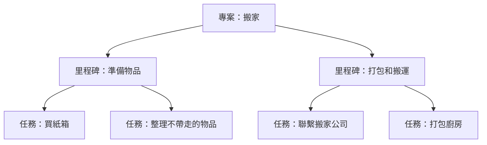

很多人一開始會把專案當成「更大的任務」。這樣想也能用，但很快就會遇到一個問題：一個專案通常不是做一次就結束，而是要在幾天、幾週甚至更久的時間裡反覆推進。

在 GranoFlow 裡，更穩的理解是：任務回答「今天具體做什麼」，專案回答「這些任務共同服務哪個目標」。里程碑夾在中間，幫你把一段長期推進拆成幾個能判斷進展的階段。

## 一個真實場景

假設你準備搬家。「買紙箱」「打包廚房」「聯繫搬家公司」都是任務，因為它們可以被具體執行；「搬家」本身更適合做成專案，因為它會持續一段時間，也會產生一組相關任務。

把這些任務放進同一個專案後，你不需要靠記憶到處找它們。每次回來時，先看專案做到哪一段，再決定今天推進哪一步。

## 專案、里程碑和任務

這張關係圖的重點不是層級越多越好，而是讓不同問題放在合適的位置：目標放進專案，階段放進里程碑，真正要動手的事寫成任務。

## 專案和領域的關係

專案不是孤立存在的。很多專案背後都有一個更長期的方向，比如學習、工作、健康、家庭或個人作品。領域頁面適合承接這種長期方向；專案則承接其中一段需要推進的目標。

可以把領域想成花園的分區，把專案想成其中一塊正在整理的區域。分區不要求你每天都有大動作，但它能提醒你：這一組專案到底是在照顧哪個方向。

| 如果你在想... | 更適合放在哪裡 |
| --- | --- |
| 我長期想持續照顧的方向是什麼 | 領域 |
| 這個方向下最近要完成的一段目標是什麼 | 專案 |
| 今天能推進的下一步是什麼 | 任務 |

## 何時該建專案

| 你的情況 | 更適合的做法 | 原因 |
| --- | --- | --- |
| 只有一兩步，今天或明天就能做完 | 直接建立任務 | 專案會讓簡單事情變重 |
| 會產生三項以上相關任務，並持續超過一週 | 建立專案 | 需要一個地方承接上下文和進度 |
| 有幾個明顯階段，例如準備、執行、檢查 | 專案裡再加里程碑 | 階段能幫助你判斷下一步 |
| 只是同類任務的橫向分類 | 使用標籤或其他檢視 | 專案更適合承接一個目標 |

::::tip[一個省事判斷]
如果你每次看到這件事都要重新回憶背景，它多半值得建成專案；如果你一看任務標題就知道下一步，直接放在任務裡通常夠了。
::::

## 專案能做什麼，不能取代什麼

專案能把相關任務放在一起，用里程碑拆階段，並展示整體進度。它適合承接「持續推進」的事情。

但專案不會替你決定哪天做哪件事。任務是否出現在今日檢視或日曆裡，仍然取決於日期；跨專案的橫向分類，通常還是靠標籤；每天完成了什麼，也要回到回顧裡看。

| 容易誤解 | 更穩的理解 |
| --- | --- |
| 專案越多越有條理 | 專案太多也會變成另一種收集箱 |
| 所有長期想法都要馬上建專案 | 先等它產生明確任務，再建也來得及 |
| 建了專案，任務就會自動安排時間 | 專案負責歸屬，日期仍要在任務上處理 |

## 下一步

理解專案這層容器後，可以繼續看「建立專案」。那一篇會講從哪裡建立、名稱怎麼寫，以及先建空白專案還是先收集任務。
