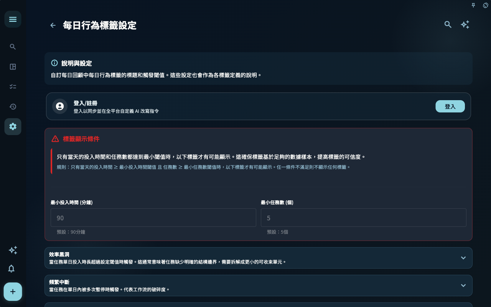
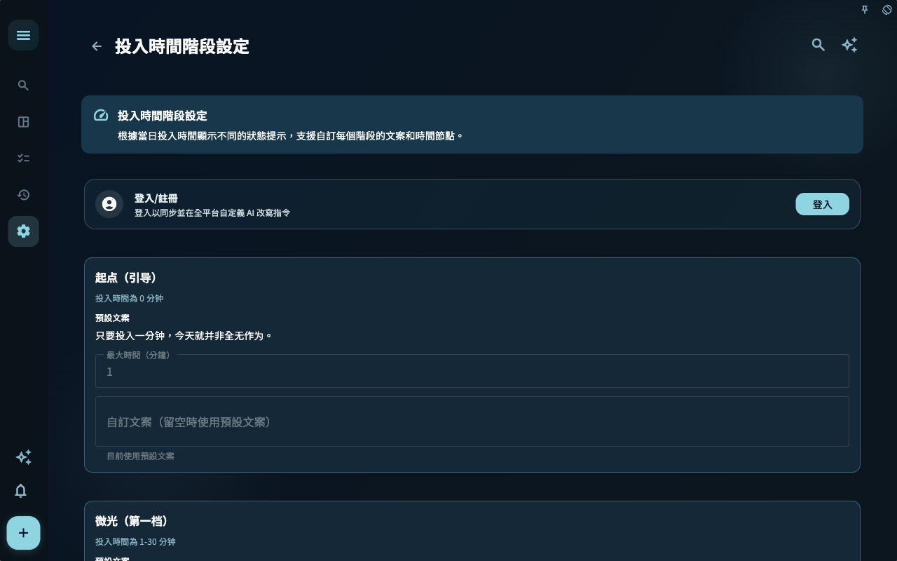
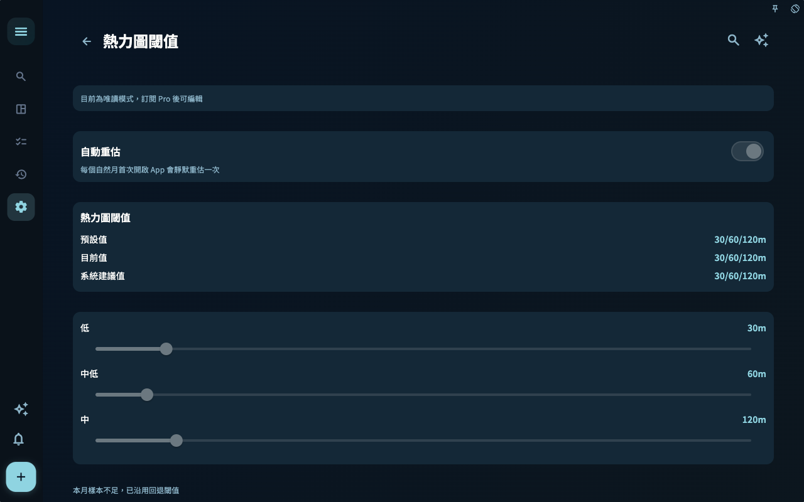
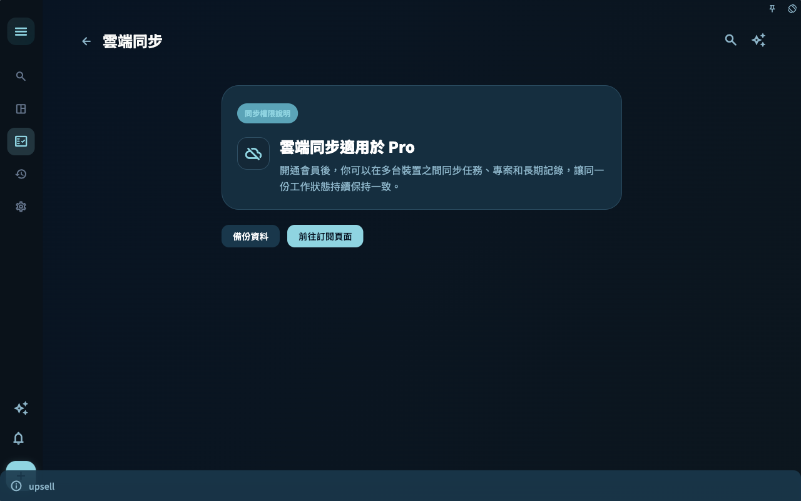
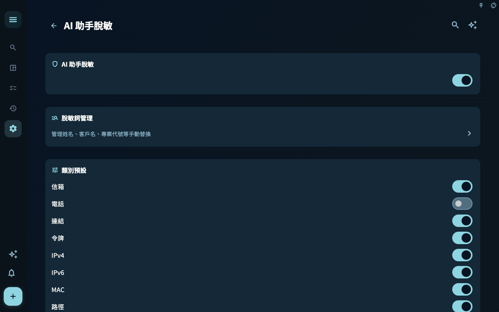
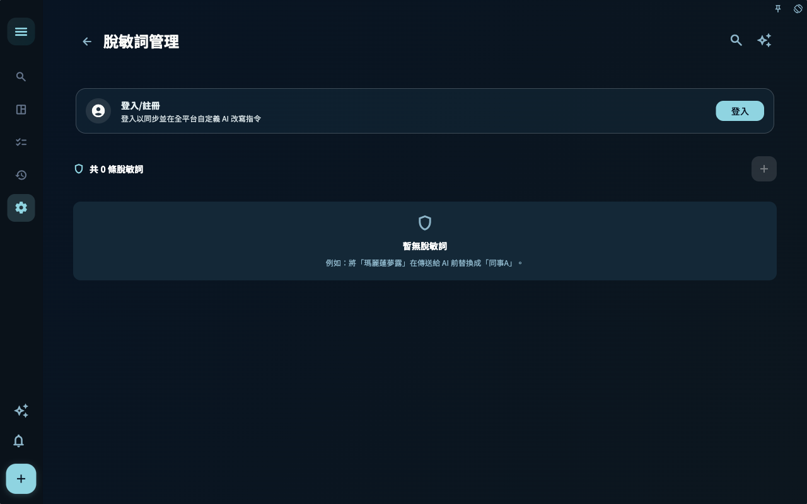

異常處理先看頁面是否正常，再看資料、同步、權限和提示詞相關入口。

## 如何使用這一頁
1. 先確認你要完成的目標，而不是從按鈕名稱開始記。
2. 對照截圖確認目前頁面、狀態和入口是否一致。
3. 完成一步後看頁面回饋，再決定是否進入下一頁。

## 截圖

用來確認頁面入口、主要狀態和可繼續操作的位置。

用來確認頁面入口、主要狀態和可繼續操作的位置。

用來確認頁面入口、主要狀態和可繼續操作的位置。

用來確認頁面入口、主要狀態和可繼續操作的位置。

用來確認頁面入口、主要狀態和可繼續操作的位置。

用來確認頁面入口、主要狀態和可繼續操作的位置。

## 邊界
截圖只證明目前 macOS、深色、橫向和手冊 seed 下的可見狀態。帳號、訂閱、同步、AI 和外部工具頁面會隨權限和本機狀態變化。
