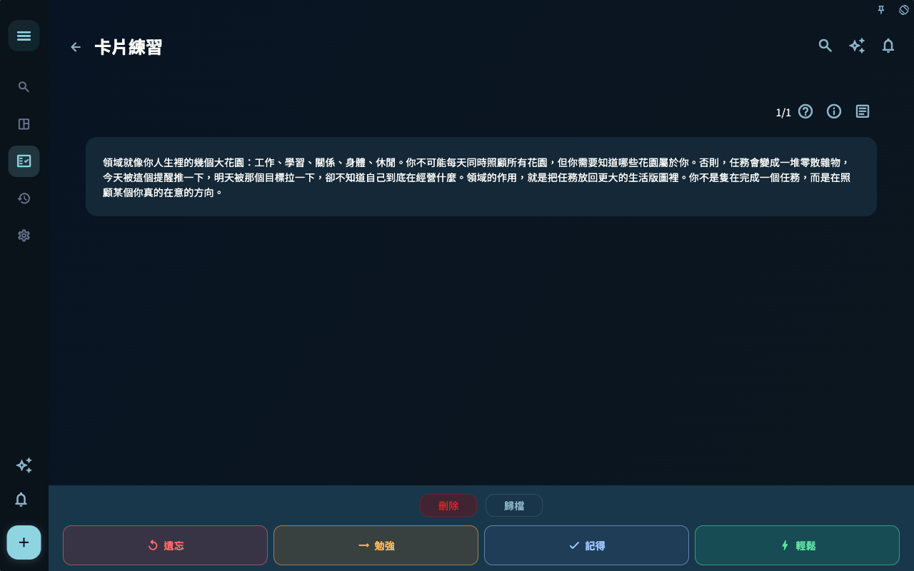
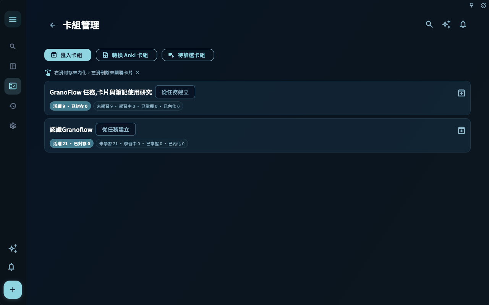
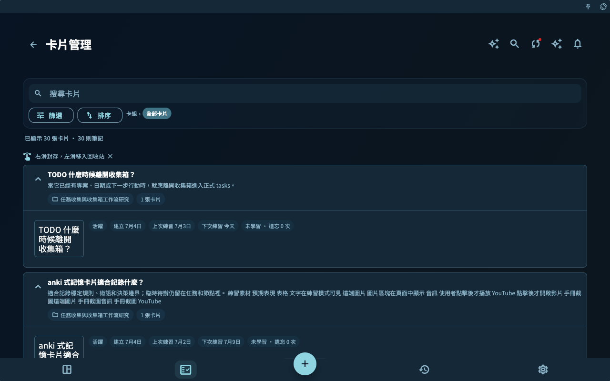
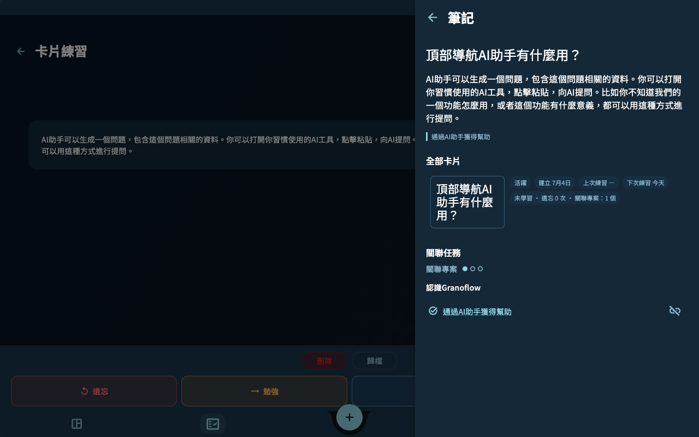

記憶卡片是 GranoFlow 把經驗帶回未來行動的方式。它不是要求你背誦每句話，而是讓一個判斷、問題或提醒在下一次工作時更容易想起。

## 先完成一次卡片學習

這張示例卡片問的是「什麼是領域？」。領域可以理解為你長期在照顧的生活或工作方向，例如工作、學習、關係、身體和休閒。

1. 打開卡片練習頁面後，先只看問題。
2. 先用自己的話回答，不急着看答案。
3. 點擊 **顯示答案**。

頁面會進入答案狀態。

評分只是記錄這一次提取答案的感覺：遺忘、勉強、記得或輕鬆。選貼近真實感受的一項，比選漂亮分數更有用。

## 統計與管理

看整體狀態用統計頁；按集合整理用卡組列表；找單張卡片用卡片管理；需要來源語境時，在學習頁打開筆記面板。
