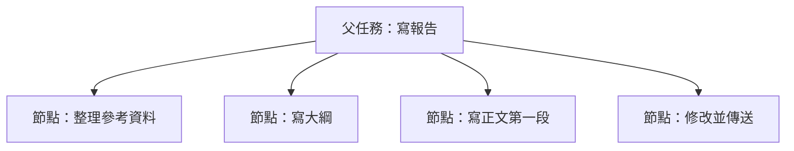

有些任務不是你不想做，而是標題太大，看一眼就不知道從哪裡下手。比如「寫完整份報告」會讓人卡住；「整理參考資料」「寫大綱」「寫正文第一段」就更容易開始。

在 GranoFlow 裡，拆解任務就是把一個大任務拆成節點。節點不是新的專案，也不是獨立目標，它只是這條任務裡的小步驟。

## 什麼任務需要拆

| 任務標題 | 問題 | 拆成下一步 |
| --- | --- | --- |
| 寫報告 | 太大，不知道先做什麼 | 整理參考資料 |
| 準備發布 | 範圍太寬 | 列出發布前檢查項 |
| 學習新工具 | 結果不清楚 | 跑通第一個範例 |
| 整理資料 | 無法判斷完成 | 把本週檔案移到一個資料夾 |

一個好節點應該能直接執行。它不一定很小，但最好能在你坐下來以後馬上知道怎麼開始。

## 節點與父任務的關係

父任務回答「這一整件事是什麼」，節點回答「下一步怎麼做」。節點完成後，父任務的進度會更新；所有節點完成後，父任務才適合被標為完成。

如果你又給已完成的父任務加了新的未完成節點，父任務可能會回到待辦。這不是錯誤，而是在提醒你：這件事又多了一個未完成步驟。

## 怎麼拆解

打開任務詳情，找到步驟或節點區域，加入第一個子步驟。先寫最近能做的一兩步就夠了，不必一次把所有步驟想完。

| 操作 | 什麼時候用 | 結果 |
| --- | --- | --- |
| 新增節點 | 任務太大，需要下一步 | 任務變得更容易開始 |
| 勾選節點 | 一個步驟做完 | 父任務進度更新 |
| 調整順序 | 步驟先後不對 | 執行順序更清楚 |
| 提級或縮排 | 步驟層級不對 | 結構更貼近實際 |
| 刪除節點 | 這一步不再需要 | 節點移除；有子節點時先處理子節點 |

在桌面端，節點左側的拖曳手柄可以調整順序或層級；鍵盤焦點在節點列表上時，可以用 `Alt+↑` / `Alt+↓` 上下移動，用 `Alt+←` / `Alt+→` 提級或縮排。

::::tip[不要巢狀太深]
兩層通常已經夠用。超過兩層還說不清楚，可能代表它不該只是一個任務，而是應該拆成專案、里程碑或幾條獨立任務。
::::

## 拆任務，還是建里程碑

| 更適合用節點 | 更適合用里程碑 |
| --- | --- |
| 幾小時到幾天能完成 | 會持續幾週或更久 |
| 步驟緊密相依 | 階段相對獨立 |
| 只服務一條任務 | 需要統籌多條任務 |
| 目標還是同一件事 | 每個階段都有獨立結果 |

簡單判斷：節點回答「下一步怎麼做」，里程碑回答「專案做到哪個階段了」。

## 下一步

任務拆小以後，可以回到任務詳情繼續執行；如果這些步驟已經變成一段長期目標，就去專案章節，用專案和里程碑承接。
