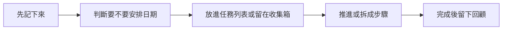

在 GranoFlow 裡，任務不是一個必須一次寫完整的小檔案。更好用的方式是：先把要做的事放下來，再決定它要不要安排日期、歸入專案、拆成步驟，或者完成後留下回顧。

很多任務工具會讓你一開始就填很多欄位。GranoFlow 的任務系統更像一張工作檯：先把便條攤開，今天要做的拿到手邊，做完的留下痕跡，不需要的收起來。

## 任務列表承接正在推進的事

任務列表適合看已經決定要推進的事。你會在這裡看到按時間分割的任務，像是今天、明天、本週、本月或更晚。

這張圖真正要看的不是按鈕數量，而是任務進入清單後的狀態：它已經不只是一個想法，而是有了日期、順序或下一步。接下來你可以點開任務補欄位，也可以直接在清單開始專注或完成。

## 從想法到完成

這條線不用一次走完。很多時候，你只需要先完成第一步：把事情寫下來。

## 任務、專案和領域怎麼分工

| 你在問的問題 | 更適合放在哪裡 | 例子 |
| --- | --- | --- |
| 現在具體要做什麼 | 任務 | 寫第三章初稿、聯絡搬家公司 |
| 這組任務服務哪個階段目標 | 里程碑 | 錄製完成、上線檢查通過 |
| 這段時間要推進哪個目標 | 專案 | 發布課程、完成搬家 |
| 這個目標屬於哪個長期方向 | 領域 | 學習、工作、健康 |

不是每個任務都需要往上連接。能直接完成的小事，寫成任務就夠了；會持續一段時間、產生多項任務的目標，再放進專案。

## 一般待辦和專案任務的差別

一般待辦解決的是「我下一步要做什麼」。專案任務解決的是「這一步服務哪個階段目標」。兩者都重要，但不要互相取代。

| 任務類型 | 適合例子 | 通常怎麼處理 |
| --- | --- | --- |
| 收集箱任務 | 買牙線、回覆朋友、記下一個靈感 | 先記下，之後決定是否加日期或直接完成 |
| 今日任務 | 16:00 前發出會議紀要、晚上整理課程筆記 | 加日期，做完後進入日回顧 |
| 專案任務 | 完成課程第 3 講腳本、驗證同步復原流程 | 連接專案和里程碑，必要時拆節點 |
| 歷史補登任務 | 補記上週完成的發布檢查 | 只在會影響回顧或專案記錄時補登 |

如果一件事幾分鐘就能完成，不必為了「規範」替它建立專案。如果一件事會反覆產生後續動作，或者完成後需要複盤和交接，就更適合放進專案。

## 為什麼只細排今天和明天

GranoFlow 不鼓勵你把未來每一天都排滿。未來會變，任務也會變；把下週和下個月排得太細，往往只是把計畫維護成本提前搬到今天。

所以任務列表會把今天和明天放得更具體：今天決定現在先做什麼，明天留一個清楚但不沉重的下一步。更遠的任務可以先放在本週、本月、下個月或更晚，等時間靠近再細排。

::::tip[先讓任務能被執行]
一個好任務通常能回答兩個問題：我下一步做什麼？做完後能看到什麼變化？如果標題還只是「論文」「搬家」「複習」，先把它改成一個動作。
::::

## 任務的幾種狀態

| 狀態 | 什麼時候用 | 結果 |
| --- | --- | --- |
| 待辦 | 還沒開始 | 留在對應檢視中等待處理 |
| 進行中 | 正在做 | 可以成為當前任務 |
| 已完成 | 已經做完 | 記錄完成時間，可進入回顧 |
| 已歸檔 | 暫時不需要關注 | 保留記錄，但不佔當前列表 |
| 資源回收筒 | 已刪除但未清空 | 仍有機會恢復 |

任務詳細資料負責補充任務資訊，不提供「開始專注」和「完成任務」按鈕。做完一件事時，回到任務清單勾選核取方塊；開始專注則使用應用程式目前提供的專注入口。

## 第一次使用怎麼開始

點 **+**，寫下今天最想推進的一件事，然後儲存。先不要急著建專案、加標籤、拆步驟。

等你發現這件事需要持續推進，再往上加專案；等你發現任務太大，再拆節點；等你完成了，再留下回顧。任務系統的價值不是讓你一開始整理得很漂亮，而是讓下一步更容易被拿起來。

## 下一步

如果你只是想先記下來，繼續看「收集箱」。如果你已經知道要做什麼，繼續看「建立與編輯任務」。
